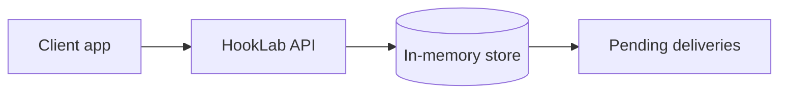
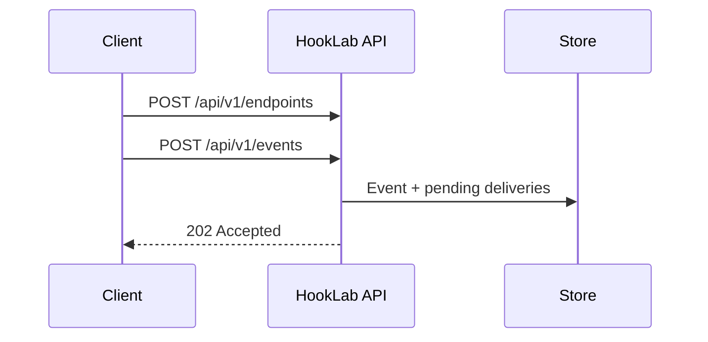

# Architecture (Milestone 2)



Milestone 1’s **producer → consumer** loop remains in `examples/` for learning and later end-to-end tests. The platform path is now:



Outbound HTTP to subscriber URLs is **not** wired yet (Milestone 4).

## Repository layout

```
hooklab/
├── apps/
│   └── api/                 # Fastify REST API
├── packages/
│   └── shared/              # Types, validation, subscription matching
├── examples/
│   ├── webhook-consumer/    # Sample subscriber
│   └── event-producer/        # CLI: direct webhook or HookLab API
├── docs/
└── prisma/                  # Milestone 3
```

## Design choices

### Modular monolith

One codebase, multiple **processes** later (API, dispatcher, worker). Shared types live in `@hooklab/shared` so the worker will reuse the same event shape and validators without copy-paste.

### In-memory store (temporary)

Trade-off: fast to learn subscription matching and API contracts without Docker Postgres. Cost: no durability, no multi-instance safety. Milestone 3 swaps `MemoryStore` for Prisma repositories behind the same route handlers pattern.

### Validation in `shared`

URL and event-type rules are pure functions with unit tests. The API only maps validation failures to HTTP 400 — keeps handlers thin and tests fast.

### Secrets

Endpoint signing secrets are generated on create and returned once as `signingSecret`. List/get responses strip secrets — practice for production APIs.

## Event JSON

**Publish request** (`POST /api/v1/events`):

```json
{ "type": "task.completed", "data": { "taskId": "task_123" } }
```

**Stored event** includes server-assigned `id`, `organizationId`, and timestamps.

**Future webhook body** (Milestone 4+) will mirror Milestone 1’s consumer shape: `id`, `type`, `createdAt`, `data`.

## Planned processes (later milestones)

| Process | Milestone |
|---------|-----------|
| API server | 2 ✓ |
| Delivery worker | 4–6 |
| Outbox dispatcher | 7 |
| PostgreSQL | 3 |
| Redis / BullMQ | 6 |
