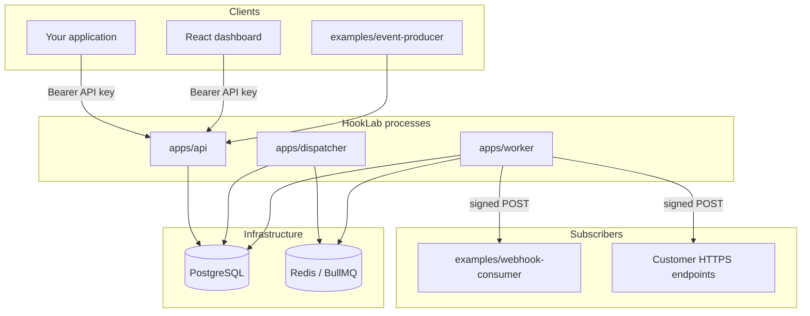
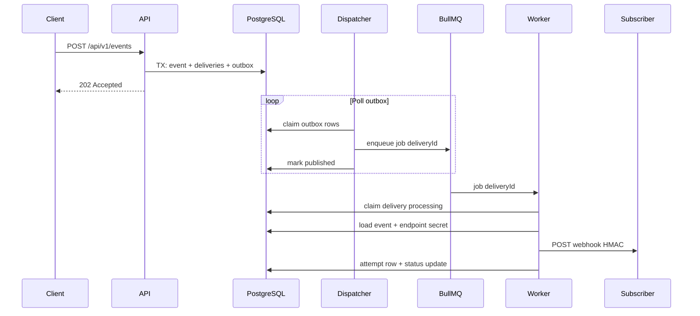

# Architecture

HookLab is a **modular monolith**: one TypeScript repo, several **independent Node processes**, shared libraries, and **PostgreSQL as the source of truth** for events and delivery state. Redis/BullMQ is a **transport layer**, not the system of record.

## System context



## End-to-end delivery path



**Guarantee:** at-least-once **execution** inside HookLab (retries, duplicate jobs tolerated). **Exactly-once HTTP delivery** to arbitrary subscribers is not claimed.

## Components (jist)

| Piece | Path | Role |
|-------|------|------|
| **API** | `apps/api` | Auth, register endpoints, publish events, list deliveries/attempts, replay, metrics, health |
| **Dispatcher** | `apps/dispatcher` | Transactional **outbox** → enqueue `webhook-deliveries` jobs idempotently |
| **Worker** | `apps/worker` | Claim delivery, HTTP POST, HMAC, record attempts, retries via outbox |
| **Dashboard** | `apps/dashboard` | Vite/React UI over the same REST API |
| **Shared** | `packages/shared` | Types, validation, HMAC, retry math, SSRF checks, `deliverWebhook` |
| **Queue** | `packages/queue` | BullMQ publisher/worker helpers, Redis ping |
| **Consumer** | `examples/webhook-consumer` | Reference subscriber (verify signature, idempotent by event id) |
| **Producer** | `examples/event-producer` | CLI to publish via HookLab API or direct POST |

## Repository layout

```
hooklab/
├── apps/
│   ├── api/           # Fastify REST
│   ├── dispatcher/    # Outbox poller
│   ├── worker/        # Delivery executor
│   └── dashboard/     # React console
├── packages/
│   ├── shared/        # Domain + delivery HTTP
│   └── queue/         # BullMQ integration
├── examples/          # Learning & E2E demos
├── prisma/            # Schema + migrations
├── docs/              # Deep dives per topic
├── Dockerfile         # Shared image for app processes
├── docker-compose.yml # Postgres + Redis
└── docker-compose.app.yml
```

## Data ownership

| Concern | Authoritative store |
|---------|---------------------|
| Events, endpoints, deliveries, attempts | PostgreSQL |
| Retry schedule, dead-letter, replay | PostgreSQL (`next_retry_at`, outbox rows) |
| In-flight job queue | Redis (BullMQ); jobs keyed by `deliveryId` |
| API keys | SHA-256 hash in `organizations` |
| Endpoint signing secrets | AES-256-GCM ciphertext in DB |

## Cross-cutting concerns

| Topic | Where | Doc |
|-------|--------|-----|
| Outbox + retries | API TX, dispatcher, worker | [retry-strategy.md](retry-strategy.md) |
| Idempotency | Publish header + delivery claim | [idempotency.md](idempotency.md) |
| HMAC + SSRF | `packages/shared`, worker | [security.md](security.md) |
| Leases & recovery | Worker + dispatcher loops | [failure-scenarios.md](failure-scenarios.md) |
| Schema | Prisma | [database-design.md](database-design.md) |

## Local vs Docker

- **Dev:** `npm run dev:*` on the host; Postgres/Redis in Compose; consumer on `:4000`.
- **App tier:** optional `docker-compose.app.yml` runs API, dispatcher, worker in one image ([deployment.md](deployment.md)).

## Mental model

1. **Publish** = durable commit in Postgres (never block on HTTP to subscribers).
2. **Dispatch** = bridge committed work to Redis safely (repeatable).
3. **Deliver** = worker owns one delivery at a time; Postgres records every attempt.
4. **Observe** = dashboard + metrics + delivery attempt APIs.

Further reading: [overview.md](overview.md) (doc index + glossary).
