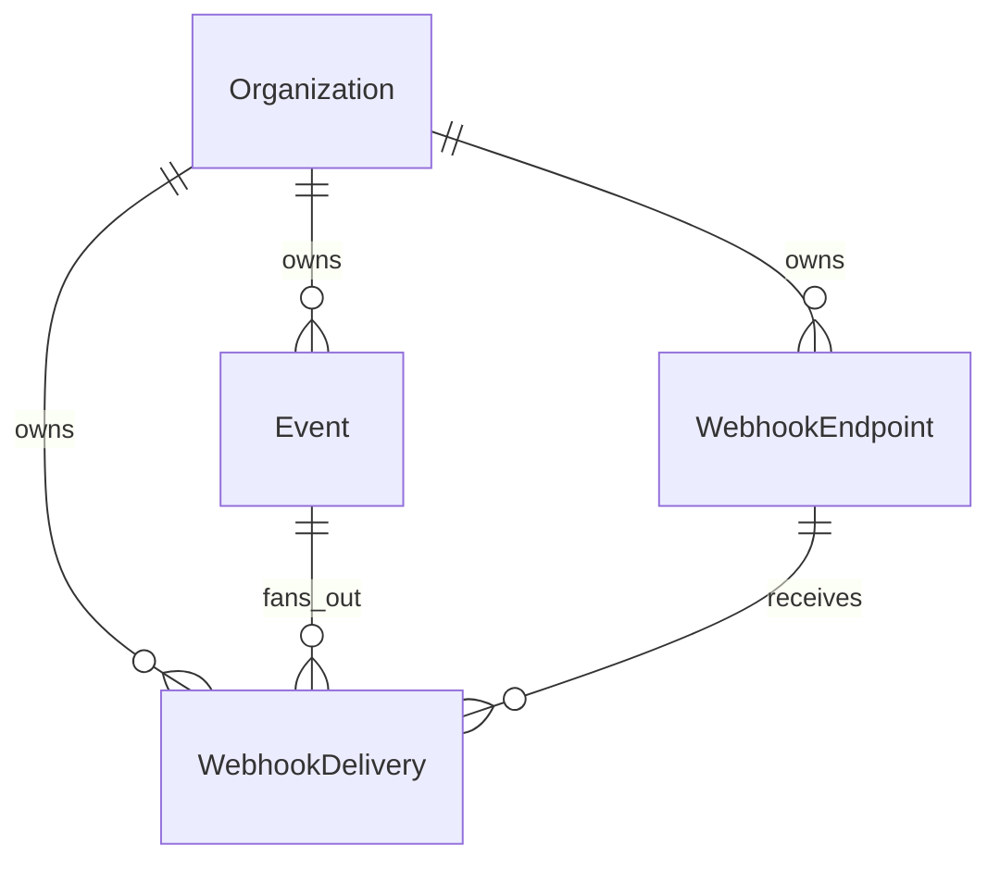

# Database design (Milestone 3)

HookLab stores durable state in **PostgreSQL** via **Prisma**. Redis remains unused until Milestone 6.

## Entity relationships

## Tables

| Table | Purpose |
|-------|---------|
| `organizations` | Tenant boundary; stores **hashed** API key only |
| `webhook_endpoints` | Subscriber URLs, subscriptions, encrypted signing secret |
| `events` | Immutable published events (`payload` JSON) |
| `webhook_deliveries` | Per-endpoint delivery state machine (`pending`, …) |

## Organization authentication

- Plaintext API keys are never stored.
- Client sends `Authorization: Bearer hl_live_…`
- Server computes `SHA-256(apiKey)` and looks up `organizations.api_key_hash` (unique index).

High-entropy random keys make SHA-256 sufficient here; the key itself is the secret.

## Endpoint signing secrets

- Generated as random hex on endpoint create.
- Encrypted at rest with **AES-256-GCM** using `ENDPOINT_SECRET_ENCRYPTION_KEY` (outside the DB).
- Ciphertext stored in `secret_ciphertext`; decryption happens in the worker path (Milestone 4+).

## Publish transaction

`POST /api/v1/events` runs in a single Prisma `$transaction`:

1. Insert `events` row  
2. Load enabled endpoints for the organization  
3. Filter by subscription (application-level match)  
4. Insert `webhook_deliveries` rows with `status = pending`  

This mirrors the future **outbox** step (Milestone 7) without enqueueing yet.

## Indexes

- Foreign keys + `organization_id` indexes enforce **tenant isolation** in queries.
- `events (organization_id, created_at desc)` supports event history listing.
- Delivery indexes on `event_id` and `endpoint_id` support troubleshooting views.

## Not in schema yet

- `delivery_attempts`, `outbox_events` — Milestones 4–7  
- Idempotency keys — Milestone 7  
