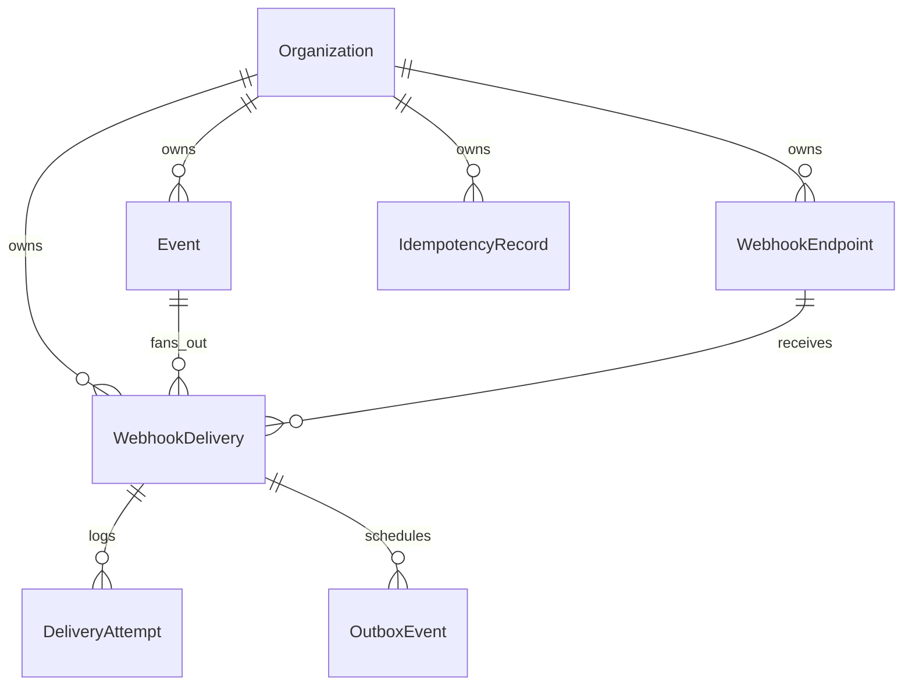

# Database design

PostgreSQL holds all durable application state. Redis is not used for history or delivery status.

## Entity relationships

## Tables

| Table | Purpose |
|-------|---------|
| `organizations` | Tenant; hashed API key |
| `webhook_endpoints` | URLs, subscriptions, encrypted signing secret |
| `events` | Published events (`payload` JSON) |
| `webhook_deliveries` | Per-endpoint delivery state |
| `delivery_attempts` | One row per HTTP try |
| `outbox_events` | Queue publish queue (transactional outbox) |
| `idempotency_records` | Publish dedupe by `Idempotency-Key` |

## Organization authentication

- Plaintext API keys are never stored.
- Client sends `Authorization: Bearer hl_live_…`
- Server hashes with SHA-256 and matches `organizations.api_key_hash`.

## Endpoint signing secrets

- Random secret generated on create; returned once in the create response.
- Encrypted with **AES-256-GCM** using `ENDPOINT_SECRET_ENCRYPTION_KEY`.
- Worker decrypts when signing outbound webhooks.

## Publish transaction

`POST /api/v1/events` runs in one transaction:

1. Optional idempotency lookup  
2. Insert `events`  
3. Insert matching `webhook_deliveries` (`pending`)  
4. Insert `outbox_events` (`pending`) for each delivery  

## Indexes

- `organization_id` on tenant-scoped tables  
- `events (organization_id, created_at desc)`  
- `webhook_deliveries` by status and time for operations views  
- `outbox_events (status, available_at, created_at)` for the dispatcher  
- Unique `(delivery_id, attempt_number)` on attempts  
