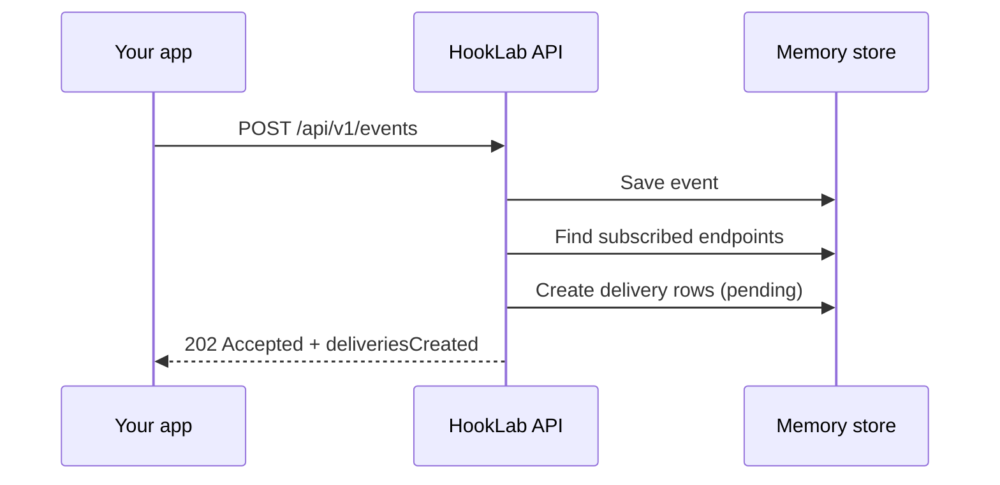

# Event lifecycle (Milestone 2)

HookLab separates **accepting** an event from **delivering** it. Milestone 2 implements acceptance and subscription matching only; HTTP delivery arrives in Milestone 4.

## Stages

| Stage | Milestone | What happens |
|-------|-----------|----------------|
| Publish | 2 | Validate payload, assign `evt_*` id, persist event |
| Match | 2 | Select enabled endpoints whose `subscribedEvents` contains the event type |
| Schedule | 4–7 | Outbox + BullMQ enqueue (not built yet) |
| Deliver | 4+ | Worker POSTs to endpoint URL |
| Retry | 7+ | Backoff and dead-letter |

## Why HTTP 202?

The client only needs proof that HookLab **durably accepted** the event. Delivery is asynchronous. `202 Accepted` communicates that the request was valid and persisted; it does not mean webhooks were delivered.

## Subscription matching

Matching is a filter over endpoints:

- `enabled === true`
- `subscribedEvents` includes the published `type`

Fan-out: one delivery record per matching endpoint. If three endpoints subscribe to `task.completed`, one publish creates three `pending` deliveries.

## What is not implemented yet

- API key authentication (Milestone 3)
- PostgreSQL persistence (Milestone 3)
- Outbound HTTP (Milestone 4)
- HMAC headers (Milestone 5)
