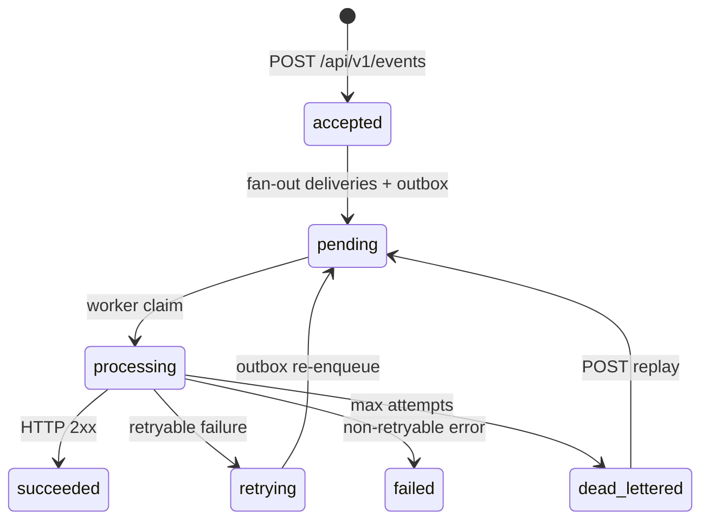
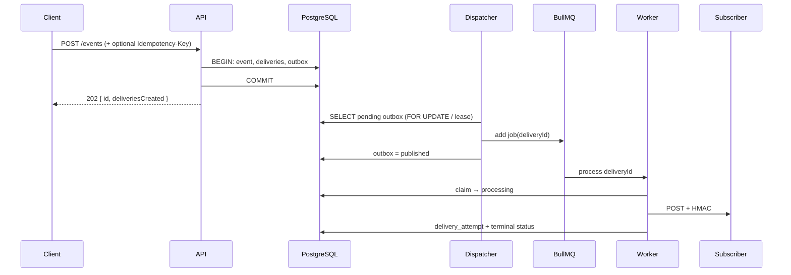

# Event lifecycle

HookLab separates **accepting** an event from **delivering** it. The API returns as soon as the database transaction commits; subscribers are notified asynchronously.

## Full pipeline (current)

## Stages

| Stage | Where | What happens |
|-------|--------|----------------|
| **Authenticate** | API | `Authorization: Bearer hl_live_…` → organization |
| **Validate** | `@hooklab/shared` | Event type, `data` object, endpoint URLs (SSRF rules) |
| **Persist** | API + Prisma | Event row; one `webhook_deliveries` per matching endpoint |
| **Outbox** | Same transaction | `outbox_events` row per delivery to enqueue |
| **Dispatch** | `apps/dispatcher` | Publish to Redis; mark outbox published (idempotent) |
| **Claim** | `apps/worker` | One winner per delivery; stale `processing` recovered |
| **Deliver** | `deliverWebhook` | DNS SSRF check → POST → record attempt |
| **Retry** | Worker + PG | Schedule `next_retry_at`, new outbox row (not duplicate schedulers in Redis) |
| **Dead letter** | Worker | `attemptCount >= max` → `dead_lettered` |
| **Replay** | API | Manual `pending` + outbox; history preserved |

## Why HTTP 202?

`202 Accepted` means the event is **durably stored** and deliveries are **scheduled**. It does not mean subscribers have already received the webhook.

## Subscription matching

Fan-out predicate per endpoint:

- `enabled === true`
- `subscribedEvents` includes the published `type`

One publish with three matching endpoints → three delivery rows (same `eventId`, different `endpointId`).

## Idempotency (publish)

Same `Idempotency-Key` + same body → same `evt_*` id returned; no second event row ([idempotency.md](idempotency.md)).

## Idempotency (delivery)

- Terminal `succeeded` → worker skips further HTTP.
- Unique `(deliveryId, attemptNumber)` prevents duplicate attempt rows.
- Duplicate BullMQ jobs → second worker gets `skipped` on claim.

See [architecture.md](architecture.md) for component diagram.
