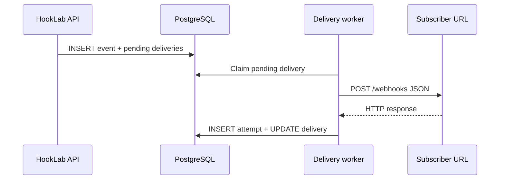

# Webhook delivery (Milestone 4)

HookLab now **sends HTTP POST requests** to subscriber endpoints from a **separate worker process**. The API still only accepts events and creates `pending` deliveries.



## Worker (BullMQ)

1. API enqueues job `{ deliveryId }` on Redis queue `webhook-deliveries`  
2. Worker claims the job (concurrency configurable)  
3. Sets delivery `pending` → `processing`  
4. POSTs signed JSON to `endpoint.url`  
5. Records `delivery_attempts` and final delivery status  

Details: [queue.md](./queue.md).

## Request format

**Headers** (see [security.md](./security.md) for HMAC):

- `Content-Type: application/json`
- `X-HookLab-Event`
- `X-HookLab-Delivery`
- `X-HookLab-Timestamp` (unix seconds)
- `X-HookLab-Signature` (`v1=<hmac-sha256 hex>`)

**Body:**

```json
{
  "id": "evt_…",
  "type": "task.completed",
  "createdAt": "2026-…",
  "data": { }
}
```

Redirects are not followed (`redirect: "manual"`). Each delivery re-validates the resolved destination ([security.md](security.md)).

## Status semantics (Milestone 4)

| Result | Delivery status |
|--------|-----------------|
| HTTP 2xx | `succeeded` |
| HTTP 4xx/5xx or network error | `failed` |

Retries, dead-lettering, and replay are documented in [retry-strategy.md](retry-strategy.md) (Milestone 7).

## Idempotency

If a delivery is already `succeeded`, the worker does not send again.

**Milestone 8:** `processing` leases and recovery jobs reset stale deliveries to `retrying` and re-enqueue via the outbox. See [failure-scenarios.md](failure-scenarios.md).

## End-to-end local demo

```text
Terminal 1: npm run dev:consumer
Terminal 2: npm run dev:api
Terminal 3: npm run dev:dispatcher
Terminal 4: npm run dev:worker
```

Register endpoint URL `http://127.0.0.1:4000/webhooks`, publish via API — consumer should log the event within a few seconds.
