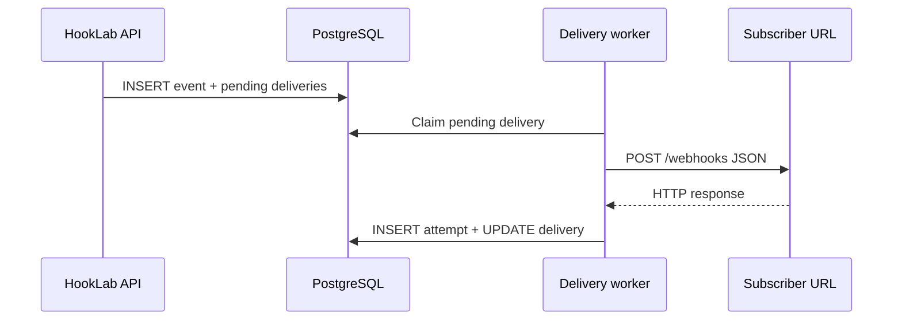

# Webhook delivery

Outbound delivery runs in **`apps/worker`**. The API persists events and `pending` deliveries but does not call subscriber URLs during the publish request.



## Worker

1. Dispatcher enqueues `{ deliveryId }` on queue `webhook-deliveries`  
2. Worker consumes the job (configurable concurrency)  
3. Claims delivery `pending` / `retrying` → `processing`  
4. POSTs signed JSON to `endpoint.url`  
5. Inserts `delivery_attempts` and updates delivery status  

See [queue.md](./queue.md).

## Request format

**Headers** (see [security.md](./security.md) for HMAC):

- `Content-Type: application/json`
- `X-HookLab-Event`
- `X-HookLab-Delivery`
- `X-HookLab-Timestamp` (unix seconds)
- `X-HookLab-Signature` (`v1=<hmac-sha256 hex>`)

**Body:**

```json
{
  "id": "evt_…",
  "type": "task.completed",
  "createdAt": "2026-…",
  "data": { }
}
```

Redirects are not followed (`redirect: "manual"`). Each delivery re-validates the resolved destination ([security.md](security.md)).

## Status semantics

| Outcome | Typical status |
|---------|----------------|
| HTTP 2xx | `succeeded` |
| Retryable HTTP / network | `retrying` (then outbox) |
| Non-retryable HTTP | `failed` |
| Max attempts | `dead_lettered` |

Details: [retry-strategy.md](retry-strategy.md).

## Idempotency

Terminal `succeeded` deliveries are not sent again. Stale `processing` rows are recovered via leases and outbox re-enqueue ([failure-scenarios.md](failure-scenarios.md)).

## End-to-end local demo

```text
Terminal 1: npm run dev:consumer
Terminal 2: npm run dev:api
Terminal 3: npm run dev:dispatcher
Terminal 4: npm run dev:worker
```

Register endpoint URL `http://127.0.0.1:4000/webhooks`, publish via API — consumer should log the event within a few seconds.
